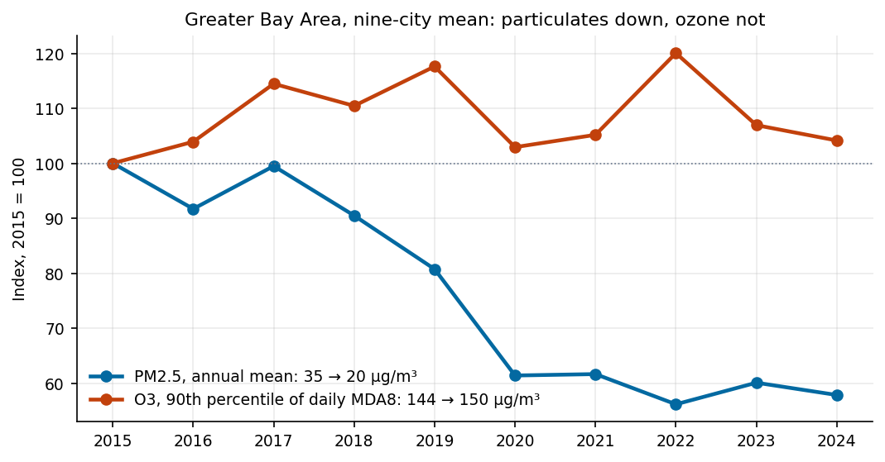
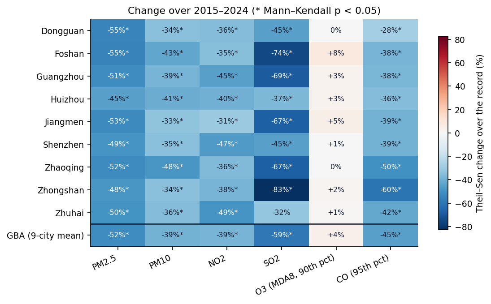
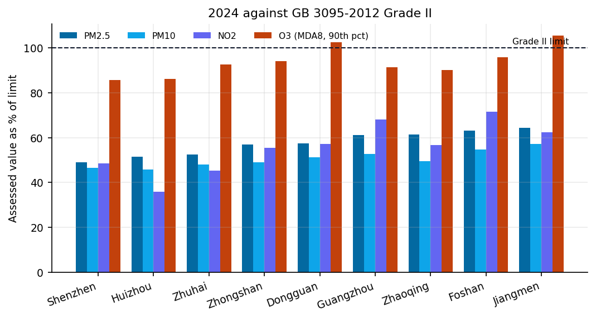
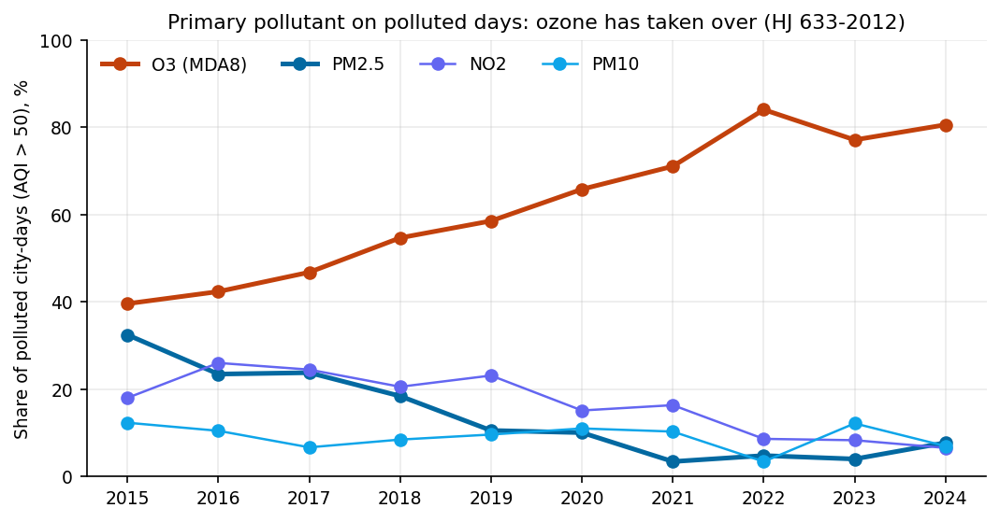
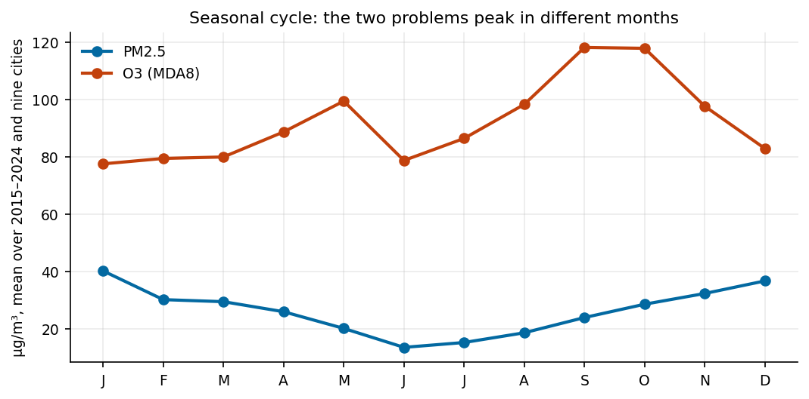
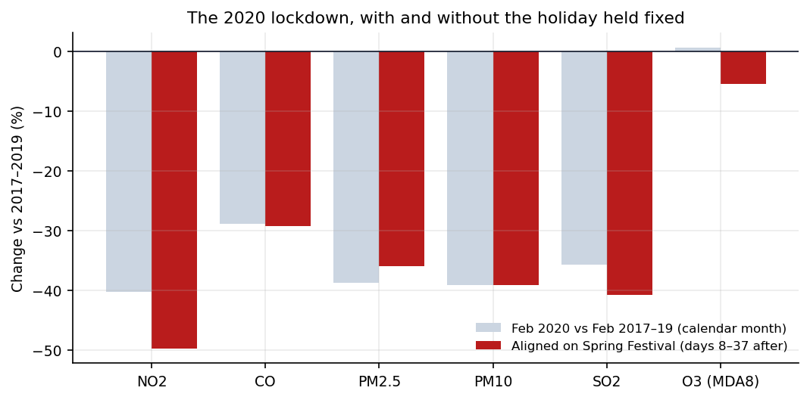

[](https://github.com/JoooDev-TPP/GBA-Air-Quality-Analysis/actions/workflows/test.yml) [](LICENSE)
<!-- TODO: DOI badge once a v1.0.0 release is archived on Zenodo -->

**Particulate pollution halved. Ozone did not move.**

Nine cities, ten years, every hour of the China National Environmental Monitoring Centre's city data. Assessed by the rules of China's own air quality standard and checked against the figures the cities publish.



## Quick start

```bash
git clone https://github.com/JoooDev-TPP/GBA-Air-Quality-Analysis
cd GBA-Air-Quality-Analysis
pip install -r requirements.txt
make test
make notebook
```

`make test` checks the validity rules, the AQI and the statistics at their boundaries. `make notebook` reruns the analysis and regenerates every figure. The daily, monthly and annual tables are committed under `data/`, so nothing is downloaded.

## Findings

### PM2.5 fell by half, in every city

The nine-city mean went from 34.8 µg/m³ in 2015 to 20.1 in 2024: a Theil–Sen trend of −1.91 µg/m³ a year, −52% over the record (Mann–Kendall p = 0.0004). Every one of the nine cities fell by between 45% and 55%, and every one of those trends is significant. Region-wide, NO2 fell 39% and SO2 59%, and every city's NO2 trend is significant.



<!-- outputs/pm25_trend_all_cities.png is not used: its city labels overlap at 2024. Fix the labels, then it can sit beside this heatmap. -->

### Ozone did not

The standard assesses ozone on the 90th percentile of the daily maximum 8-hour mean. That value was 144 µg/m³ in 2015 and 150 in 2024, a change of +4% with no significant trend (p = 0.48), in the region or in any single city. It moves with the weather. The regional value crossed the 160 µg/m³ limit in 2017, 2019 and 2022, peaked at 173 in 2022, and fell back each time.

In 2024 ozone is the only pollutant still over the national limit anywhere in the region: Dongguan at 102% of the limit and Jiangmen at 105%. Every city is inside the limit for everything else, with PM2.5 at 49–64% of it and NO2 at 36–72%.



### Ozone now sets the AQI on four polluted days in five

Every city-day is scored by HJ 633-2012: each pollutant's sub-index from the standard's table, and the AQI as the largest. Ozone was the primary pollutant on 40% of polluted days (AQI above 50) in 2015 and 81% in 2024, peaking at 84% in 2022. PM2.5 went the other way, from 32% to 8%.

Whichever ozone statistic is taken, the change is upward and not statistically significant: the 90th percentile of MDA8 +4% (p = 0.48), its annual mean +9% (p = 0.11). Ozone has not got much worse. It became the main problem because everything else got better.



### The two problems peak in different seasons

PM2.5 is a winter problem: highest in January (40 µg/m³), lowest in June (14). Ozone peaks in September and October (118) and dips in June. That fits the summer monsoon bringing clean marine air, cloud and rain, and the dry, sunny autumn bringing the opposite. Controlling one pollutant does not help with the other on the same calendar.

### The 2020 lockdown cut NO2 by half

Compared month for month, February 2020 had 40% less NO2 than the Februaries of 2017–2019. But the Spring Festival moves by up to three weeks and empties Guangdong's factories every year. Aligning each year on the festival instead, days 8 to 37 after 正月初一 (Lunar New Year's Day), makes every window the post-holiday return to work, and only 2020's is also the lockdown. On that basis NO2 fell 50% and PM2.5 36%. Ozone moved by −5%. Halving NO2 did not bring ozone down, the same pattern the decade shows.

| | |
|---|---|
|  |  |

### Shenzhen is usually the cleanest

Shenzhen had the lowest annual PM2.5 in seven of the ten years. Huizhou did in 2015, and Zhuhai in 2016 and 2020.

The full analysis is in [`notebooks/analysis.ipynb`](notebooks/analysis.ipynb). Its closing summary is generated from the tables.

## Checked against published figures

| City, year | This pipeline | Published | Source |
|---|---|---|---|
| Guangzhou, 2015 | 39.4 µg/m³ | 39 | 广州市环境空气质量达标规划（2016–2025年） |
| Guangzhou, 2015 | 39.4 µg/m³ | 38.8 | Greenpeace, independent recomputation from the same CNEMC feed |
| Shenzhen, 2024 | 17.2 µg/m³ | 17 | 深圳市生态环境局，2024年12月环境空气质量状况通报 |

Both ends of the record agree to within half a microgram.

## Method

- Every day is used: 3,653 calendar days, 3,646 of them in the archive.
- Validity follows GB 3095-2012. A daily mean needs 20 hourly values, a monthly mean 27 valid days (25 in February), an annual value 324. Values short of the rule are missing and are not estimated. About 97% of city-days are valid.
- Ozone is assessed as the standard assesses it (HJ 663-2013): the daily maximum of the 8-hour running mean, requiring 14 valid 8-hour means in the 08:00–24:00 window, then the 90th percentile over the year. CO is assessed on the 95th percentile of daily means.
- A regional value exists only when all nine cities are valid. A mean over whichever cities happen to have data moves with the membership, and that movement looks like a trend. For this reason PM10 has no regional value for 2018: Dongguan, Zhaoqing and Zhongshan each fell short of 324 valid days.
- Trends are Theil–Sen with a Mann–Kendall test. Ten annual values are too few to trust least squares with one unusual year among them.
- The daily AQI follows HJ 633-2012: sub-indices from the standard's daily breakpoints, rounded up as it requires, computed only on city-days where all six pollutants are valid.
- The lockdown is measured with the holiday held fixed. A test in `tests/` shows that with no lockdown effect at all, a calendar-month comparison still reports a change of more than 5% purely from where the festival fell.

## Limits

- These are observed concentrations, not emissions. No meteorological normalisation is applied, so a trend shows what the air did, not what policy did. That matters most for ozone.
- City averages come from a changing network. Sites were added and moved over the decade, which affects comparability in ways this analysis cannot separate.
- The lockdown comparison holds the holiday fixed. It does not control for the weather of early 2020.
- Gaps in the source stay gaps. Seven days are absent from the archive, five of them 22–26 December 2018 ([`data/missing_days.txt`](data/missing_days.txt)).
- The ozone window ends at 23:00 (16 eight-hour means) because the source's hours run 0–23, while the standard's window runs to 24:00. The 14-value requirement is kept.

## Data

Hourly city-level concentrations of PM2.5, PM10, SO2, NO2, CO and O3 from the China National Environmental Monitoring Centre (中国环境监测总站) national real-time air quality publishing platform. They are archived day by day at [quotsoft.net/air](https://quotsoft.net/air/) by Wang Xiaolei, who publishes them for analysis and research. The committed tables are aggregates derived from that record for these nine cities, for non-commercial research use.

| File | Contents |
|---|---|
| `data/gba_daily_2015_2024.csv` | one row per city and day; empty where the day fails its rule |
| `data/gba_monthly_2015_2024.csv` | monthly means, by the monthly rule |
| `data/gba_annual_2015_2024.csv` | annual assessment values, including the O3 and CO percentiles |
| `data/completeness.csv` | share of days valid, per city and pollutant |
| `data/missing_days.txt` | days absent from the archive |

Units are µg/m³ throughout, except CO in mg/m³.

Rebuilding from source is optional:

```bash
# fetch every day 2015–2024 again (about two hours, resumable)
make download
# rebuild the tables from the downloaded days
make data
```

## Layout

```
gba/
  metrics.py         validity rules, MDA8, annual statistics, trends
  aqi.py             daily AQI and primary pollutant, HJ 633-2012
  analysis.py        one function per question in this README
  figures.py         the figures
scripts/
  download_cnemc.py  every day from the archive, nine cities, cached
  build_dataset.py   hourly archive to daily, monthly, annual tables
notebooks/
  analysis.ipynb     the analysis, executed
tests/               each rule tested at its boundary
outputs/             figures
```

## Changelog

**1.0 (2026-09).** Rebuilt entirely on the CNEMC monitoring record. An earlier draft of this repository used simulated data to prototype the analysis and presented it as monitoring data. None of it remains, and every figure and number above comes from the record.

## Citation and license

If you use these tables or findings, cite this repository ([`CITATION.cff`](CITATION.cff), or "Cite this repository" in the sidebar) and the underlying source: the China National Environmental Monitoring Centre national real-time air quality publishing platform, via the [quotsoft.net/air](https://quotsoft.net/air/) archive.

Code is MIT. The data is derived from the CNEMC record as described above, for non-commercial research use.

See also [Carbon-Footprint-LCA](https://github.com/JoooDev-TPP/Carbon-Footprint-LCA), which covers lifecycle emissions on China's grid, including the South grid that serves the Greater Bay Area.
